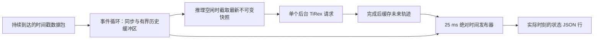

# 流式接收、异步推理与连续状态发布

流式运行器现支持 `CaptureSession(signal_schema=SignalSchema(...))` 的任意命名变量输入和联合预测，发布 `prediction`、`last_observation`、`delivery_hold` 字典。真实 UDP 可用 `stream-receive --signals-config <JSON>`；不指定时保持原车速模式。目标、协变量、源适配器和多端部署见 [通用信号指南](signals.md)。本文其余章节说明原车速实验与共有调度机制。

第三步在已有接收缓冲区、时钟同步和计算时延补偿外增加双速率运行器。数据持续进入 `TimestampedReceiver`；当前版 TiRex 在一个后台线程中以 batch=1 更新轨迹；事件循环每 25 ms 按实际发布时刻从缓存轨迹取值。TiRex 仍完整计算历史上下文，内部状态复用留给下一阶段。

采用已有的 `data/prepared/comma2k19/v1/` 因果 ZOH CAN speed。它提供 40 Hz 网格、原传感器时间和冻结划分，能够直接评价发布时刻误差，无需新下载或准备数据。开发及实验入口只选择 `vendor/tirex/` 当前版，规则见 [AGENTS.md](../AGENTS.md)。

## 运行结构



接收、时钟拟合和缓存安装均由同一个事件循环维护，后台线程只读取不可变快照。每次推理完成后再读取最新历史；中间的新包合并进缓冲区，不为每个包创建待推理任务。迟到包可以补齐历史缺口，重复包与过旧包不触发历史更新。源端会话变化时清空缓存，旧会话尚未完成的预测也会被丢弃。

`--inference-period-ms` 设置请求开始之间的最小间隔，默认 25 ms。实际计算超过此间隔时，下一次请求在完成后开始，不排队。数据未更新时，仅在缓存快要耗尽时扩展轨迹；两次推理之间仍按独立的发布时钟输出。

发布使用绝对单调时间，不把每次执行开销累加到下一周期。错过的时隙直接跳过并计数。轨迹未就绪、同步不可用或范围耗尽时，发布最后收到的速度并注明原因；没有观测时输出空值。实际发布率、模型轨迹更新率和保持值比例分别记录。

## 预测跨度与时间记录

仅覆盖一次交付时刻的轨迹不足以支持两次推理之间的连续输出。流式请求使用：

```text
queue_us     = worker_start - snapshot_time
reuse_us     = max(minimum_inference_period, compute_estimate)
coverage_us  = measured_AoI_upper + queue_us + compute_estimate + reuse_us
steps        = ceil(coverage_us / minimum_clock_rate / 25,000) + 1
```

计算耗时从后台请求开始到 GPU 完成、CPU 轨迹返回，用同一接收单调时钟测量；继续使用 17 ms 初值及 `0.8 × estimate + 0.2 × actual` 的 EWMA。一个源网格步作为覆盖余量。320 步上限沿用现有 checkpoint。

`completed_at_us` 是 CPU 轨迹就绪时刻，`delivery_time_us` 是事件循环拿到并处理结果的时刻，两者之差保留为 `dispatch_us`。交付保持值在后者选取；实际发布继续向前移动到 `publish_time_us`。这些时间都属于输出记录中的 `receiver_clock_id`，轨迹锚点属于 `source_clock_id`。例如请求最小间隔为 100 ms 时，仍需预先覆盖下一次结果到达前的这一段时间。

发布时使用当前同步映射重新计算**缓存轨迹锚点**的年龄，不能把最新数据包的 AoI 直接当成旧轨迹上的偏移。`value_at_offset()` 在观测锚点和未来中位数之间插值，范围外采用保持值。发布时间戳在历史快照完成后、选值并交给输出回调前读取；输出文件写入和下游传输不改变这个状态的目标时刻。

## 直接检查与 GPU 验收

默认入口发布接收值，不加载模型。下面的短检查按真实时间推进到达过程，确认流式文件、发布计时及报告能正常工作：

```bash
cd /home/patton/MyTirex
.venv/bin/python -m mytirex eval-stream --duration-s 1 \
  --profile jitter_loss_tail --scenario timestamp_noise
```

当前版 GPU 验收由使用者手动运行。同一数据块分别采用 25/100 ms 请求间隔，两者都以 25 ms 发布：

```bash
.venv/bin/python -m mytirex eval-stream --with-model \
  --max-series 1 --duration-s 10 \
  --profile fixed_175 --scenario shared_clock_control \
  --inference-period-ms 25 --inference-period-ms 100
```

回放在计时前预填源块前 7 s 的已到达历史并预热，默认预热 5 次；首请求不进入 EWMA，其他预热更新初值。各回放组合使用相同的预热后初值重新开始在线估计，预热请求不进入评分与计算耗时分位数。之后数据到达、推理和发布都由真实单调时间驱动。数据源及同步扰动是受控模拟，包在应用程序实际处理时记录接收时间。

## 本阶段实验

只验证持续输出及其效果，不重复第一步的六种选时方法实验。建议用冻结 test 的前 5 个数据块、三种网络、25/100 ms 两种请求间隔、每块最多 30 s。预计计时窗口合计最多 15 min；数据块不足时自动缩短并记录实际长度。模型和正式评估由使用者运行：

```bash
.venv/bin/python -m mytirex eval-stream --with-model \
  --split test --max-series 5 --duration-s 30 \
  --profile fixed_175 --profile fixed_300 --profile jitter_loss_tail \
  --scenario timestamp_noise \
  --inference-period-ms 25 --inference-period-ms 100
```

每次发布在相同的实际时间上比较以下三种值，共享同一批模型调用：

| 方法 | 发布值 | 作用 |
|---|---|---|
| `received_hold` | 最新收到的车速 | 通信时延下的直接保持参照 |
| `delivery_hold` | 最近一次推理交付时选定的车速 | 检查较慢模型更新下的交付值保持 |
| `trajectory` | 缓存轨迹在本次发布时刻的车速 | 检查连续轨迹取值的效果 |

系统指标是实际发布 Hz、间隔 P50/P95/P99、最大间隔、跳过时隙、轨迹更新 Hz、计算／线程调度／结果分发耗时、轨迹取值比例、保持值回退数。检查 `max_in_flight <= 1`、`pending_request_max = 0`，并通过 `packets_during_inference` 与合并更新数观察接收与计算的重叠。

效果指标是发布时刻速度 MAE、RMSE、Bias 和绝对误差 P95/P99。评分端按实际发布时间换算到源域，取因果 40 Hz ZOH 真值；所有方法共用该目标，不插值未来真值，也不增加模型调用。启动期间的保持值纳入整段输出评分。

## 真实 UDP 输入与下游输出

源端复用已有 `sync-source`；接收端新增 `stream-receive`，接入相同的四时间戳和车辆包协议。

源端：

```bash
.venv/bin/python -m mytirex sync-source \
  --bind 0.0.0.0 --port 5005 --duration-s 90 --split validation
```

接收端，将地址替换为源设备 IP。加 `--stdout` 后标准输出是逐条 JSON，运行日志转到标准错误，便于接入下游程序：

```bash
.venv/bin/python -m mytirex stream-receive --with-model \
  --host 192.168.1.10 --port 5005 --duration-s 60 \
  --inference-period-ms 100 --publish-period-ms 25 --stdout
```

不加 `--with-model` 可独立检查接收与连续发布。真实入口从空缓冲区启动，历史不足或异步预热时仍发布接收保持值；预热结束后用最新历史开始正式预测。接收窗口默认 256 点、至少 32 个实际观测；从网格起点接收时窗口积累约 6.4 s，首请求还可能编译内核。

程序也可直接使用 `StreamingRuntime(session, config, model=loaded_current_model, on_publish=callback)`，通过 `runtime.process(event)` 喂入已收到的包与已完成的同步交换。回调接收状态字典，需快速返回；当前 CLI 将其逐行写入文件。

## 输出与开发验证

| 文件 | 用途 |
|---|---|
| `states.jsonl` | 运行时逐行、行缓冲写出的状态，不含评分真值 |
| `publications.csv` | 每次发布的实际／计划时间、输出值、AoI、缓存锚点、覆盖范围及模式；受控回放另附评分真值 |
| `inferences.csv` | 快照、后台开始、CPU 完成、交付时间、跨度、耗时、期间收到的数据和缓存安装状态 |
| `runtime_metrics.csv` | 每个数据块／网络／时钟／请求间隔组合的调度与覆盖指标 |
| `metrics_summary.csv` / `metrics_by_series.csv` | 回放的发布时刻速度误差 |
| `report.html` / `plots/stream_trace.png` | 发布频率、误差表及连续输出、间隔和缓存覆盖图 |
| `config.json` / `metadata.json` | 配置、当前版身份、预热、实际窗口和运行状态 |
| `events.jsonl` | 真实 UDP 的接收／同步／发布查询日志，可交给已有 `replay-aoi` 检查时间测量 |

成功指针分别为 `latest_stream.json`、`latest_stream_timing.json`、`latest_stream_live.json`、`latest_stream_live_timing.json`。默认无模型检查不会覆盖 GPU 流式结果指针。真实 UDP 报告只记录调度与观测年龄，速度误差由带参考值的受控回放评价。

原流式开发阶段使用以下必要检查，共 **28 项通过**，未加载 GPU 模型。本次目录整理后的完整检查及短验收见 [维护指南](development.md#验收范围)。

```bash
.venv/bin/python -m pytest \
  tests/test_streaming.py tests/test_stream_entrypoints.py \
  tests/test_transport.py tests/test_receiver.py
```

合成 CPU 轨迹检查覆盖 70–90 ms 慢推理下的接收／发布并行、最新历史合并、缓存连续选值、无新包时覆盖刷新、耗时超估计时保持值输出、源会话变更及绝对发布时钟；入口检查覆盖配对评分和 localhost UDP。

另完成一次实际 1 s 无模型回放：40 个状态、**40.0 Hz**、跳过时隙 0，发布间隔 P50/P95/P99 为 **25.176 / 25.751 / 26.117 ms**，进程中 `torch` 与 `tirex2` 均未导入。记录见 [短检查报告](../outputs/20261011_184534_246487_stream_timing/report.html)。已有当前版 15 分钟受控流式实验保留在 [完整流式报告](../outputs/20261011_185625_913343_stream_current/report.html)：35,991 次发布，实际 39.99 Hz，最多一个在途请求、无待推理队列，轨迹取值比例约 99.91%。这是使用者完成的原实验，本次目录整理仅运行短验收。

主要代码：[`runtime.py`](../src/mytirex/streaming/runtime.py) 是共享运行器；[`replay.py`](../src/mytirex/streaming/replay.py) 是实时回放和评分；[`live.py`](../src/mytirex/streaming/live.py) 是 UDP 与连续输出入口。
